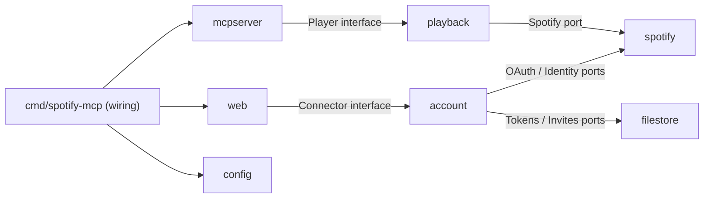

# spotify-mcp

An [MCP](https://modelcontextprotocol.io) server that lets Claude (or any MCP client) control Spotify playback: play, pause, resume, skip, list devices and move playback to another device. It speaks MCP over Streamable HTTP and is meant to run on a small home server or Kubernetes cluster behind a gateway that handles authentication.

Connecting a Spotify account needs no terminal: the server has a small web page, and you send a one-time invite link to whoever should connect their account. They press **Connect Spotify**, log in at Spotify, and that's it.

Part of Gandzs, a personal MCP gateway. One repository per connector.

## Tools

| Tool | What it does |
| :--- | :--- |
| `play` | Play a Spotify URI, or the first search result for a query. Without either, resume. Optional `device`. |
| `pause`, `resume` | Pause or resume playback. |
| `next`, `previous` | Skip forward or back. |
| `devices` | List the Spotify Connect devices Spotify currently sees. |
| `transfer` | Move playback to another device (by name, e.g. `Pixel`, or by type, e.g. `smartphone`). |
| `now_playing` | What's playing, where, and whether it's paused. |
| `search` | Search tracks, albums, artists, playlists, shows or episodes (max 10 results). |

`device` arguments take a device name, part of a name, a device type or a device ID.

When no device is active, the tools say so and list the devices you can pass, instead of failing with Spotify's bare `NO_ACTIVE_DEVICE`. A device only shows up while the Spotify app is open on it.

## Spotify's limits

Since February 2026, apps in Spotify's development mode:

- need **Spotify Premium** on the app owner's account; playback control needs Premium on the connected account too,
- allow **up to 5 users**, each added by hand under *User Management* in the developer dashboard,
- return **at most 10 search results** per request and have no batch lookups.

This server stays inside those limits. An account that isn't on the user list gets a clear message on the connect page.

## Set up

### 1. Create a Spotify app

1. Open the [Spotify developer dashboard](https://developer.spotify.com/dashboard) and choose **Create app**.
2. Redirect URI: the address of the connect page plus `/callback`, e.g. `https://spotify.example.com/callback`. Spotify only accepts HTTPS, or `http://127.0.0.1:<port>/callback` for a local run.
3. APIs used: **Web API**.
4. Under **User Management**, add every Spotify account that should be able to connect.
5. Keep the client ID and secret in your password manager.

### 2. Run it

**Locally:**

```bash
cp .env.example .env   # fill in the client ID and secret
set -a; . ./.env; set +a
go run ./cmd/spotify-mcp
```

The MCP endpoint is `http://localhost:8000/mcp`, the connect page listens on port 8080.

**Kubernetes (Helm):** create the Secret without putting the values in your shell history:

```bash
kubectl create namespace spotify-mcp
read -rs 'ID?Client ID: ' && echo && read -rs 'SECRET?Client secret: ' && echo && \
  kubectl -n spotify-mcp create secret generic spotify-mcp \
    --from-file=SPOTIFY_CLIENT_ID=<(printf '%s' "$ID") \
    --from-file=SPOTIFY_CLIENT_SECRET=<(printf '%s' "$SECRET"); unset ID SECRET
```

(`read -rs 'VAR?prompt'` is zsh; in bash use `read -rsp 'prompt' VAR`.)

Then install the chart from `oci://ghcr.io/subpathdev/charts/spotify-mcp` with at least `config.redirectURI` set. See [`charts/spotify-mcp/values.yaml`](charts/spotify-mcp/values.yaml). Route only `/connect` and `/callback` of the web port to the outside (HTTPS), and the MCP port only through your authenticating gateway.

### 3. Connect an account

Create an invite link (valid 24 h by default, `-ttl 2h` to change):

```bash
kubectl -n spotify-mcp exec deploy/spotify-mcp -- /spotify-mcp invite
# locally: go run ./cmd/spotify-mcp invite
```

Open the link, or send it to the person who should connect. The same link shows who is connected and has a **Disconnect** button. Each link works once.

## Configuration

All settings come from environment variables; see [`.env.example`](.env.example).

| Variable | Default | Meaning |
| :--- | :--- | :--- |
| `SPOTIFY_CLIENT_ID`, `SPOTIFY_CLIENT_SECRET` | (required) | From your Spotify app. |
| `SPOTIFY_REDIRECT_URI` | (required) | Must match the app's redirect URI and end in `/callback`. |
| `PUBLIC_URL` | redirect URI without `/callback` | Base of invite links. |
| `DATA_DIR` | `/data` | Token and invites. Put it on a persistent volume. |
| `PROFILE` | `default` | Name the account is stored under. |
| `MCP_ADDR`, `WEB_ADDR` | `:8000`, `:8080` | Listen addresses. |

## Security

- **The MCP endpoint has no authentication of its own.** Anyone who can reach port 8000 can control the connected account's playback. Run it behind a gateway that checks API keys or OAuth (e.g. [agentgateway](https://agentgateway.dev)), and restrict the port (the chart has an optional NetworkPolicy).
- **Least privilege at Spotify:** the server asks only for `user-read-playback-state`, `user-modify-playback-state` and `user-read-currently-playing`. It can't read playlists, the library or the e-mail address.
- **Tokens:** the refresh token lives in `DATA_DIR/tokens/<profile>.json` with mode 0600. A refresh reads, refreshes and writes the token under one lock (a mutex plus `flock`, which also covers the `invite` command's process), so a rotated refresh token is on disk before it's used and a login during a refresh is never overwritten. Nothing is logged.
- **Invites** are 256-bit random codes. Only their SHA-256 is stored; each works once and expires.
- **Login:** OAuth authorization code flow with PKCE and a `state` tied to the browser by a cookie, so a leaked callback URL can't be replayed in another browser. Cross-site form posts are rejected, and pages send no `Referer`.
- **Container:** static binary on `scratch`, non-root, read-only root filesystem, no capabilities, no Kubernetes API token.
- To revoke access entirely, use **Disconnect** and remove the app under spotify.com → Account → *Manage apps*.

Found a security problem? Please open a private security advisory on GitHub rather than a public issue.

## Development

The code is layered so the rules can be tested without HTTP, files or Spotify:



- `internal/playback` and `internal/account` are the domain: each has a `Service` with the use cases, the rules, and the ports (interfaces) it needs. Values and entities (`URI`, `DeviceID`, `ProfileID`, `InviteCode`, `Token`, …) are exported interfaces with unexported implementations, created only through constructors that validate (`ParseX`, `NewX`, `RestoreX` for stored data). The time comes from an injected `Clock`.
- `internal/spotify` (Web API + OAuth) and `internal/filestore` (JSON files) implement the ports. Wire and file formats stay unexported in them.
- `internal/mcpserver` and `internal/web` are the transports. Each depends on a small interface it defines itself.

```bash
go test -race ./...
go vet ./...
```

Commits follow [Conventional Commits](https://www.conventionalcommits.org): a merge to `main` with a `feat:` or `fix:` commit releases the image `ghcr.io/subpathdev/spotify-mcp` and the Helm chart.

## Licence

[Apache 2.0](LICENSE).
